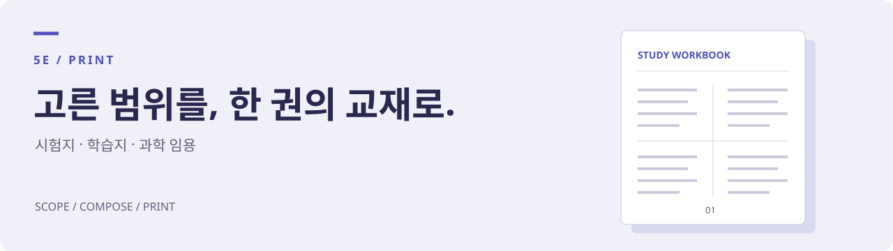
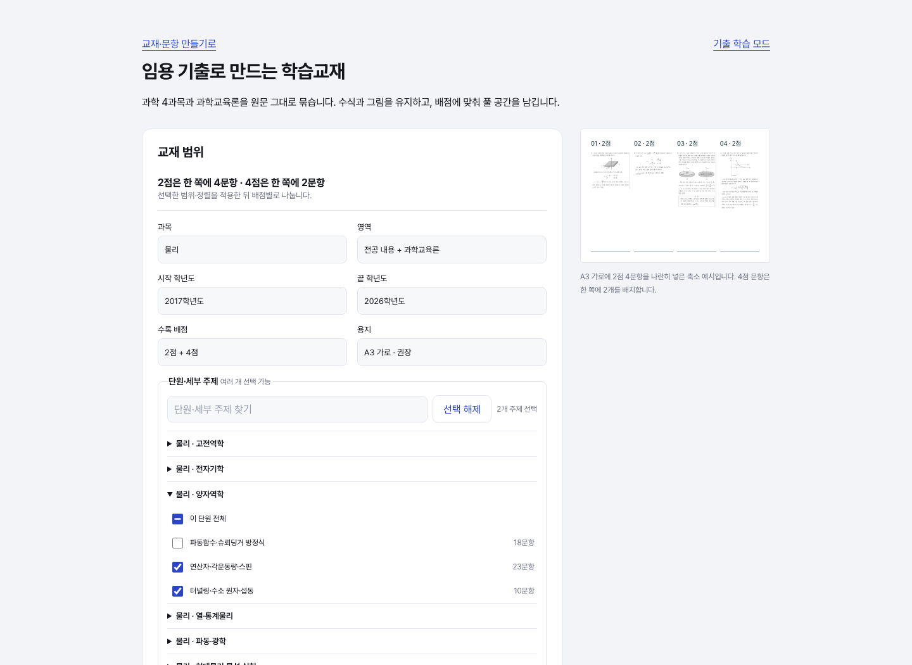

<p align="center">
  
</p>

<h1 align="center">5E_print</h1>

<p align="center">
  교과서와 기출로 만드는 시험지·학습지·임용 학습교재.<br>
  <b>범위를 고르고, 제작 요청을 복사하고, AI와 한 권을 완성하세요.</b>
</p>

<p align="center">
  <a href="https://github.com/seungyeon980808-pixel/print/tags"></a>
  <a href="LICENSE"></a>
  
</p>

<p align="center">
  <a href="https://www.5e.ai.kr/print/"><b>시험지·학습지 만들기 ↗</b></a> ·
  <a href="https://www.5e.ai.kr/print/?source=imyong"><b>임용 교재 만들기 ↗</b></a> ·
  <a href="https://www.5e.ai.kr/examlibrary/?view=study&amp;group=imyong">기출 학습 모드 ↗</a>
</p>

---

## 어떤 자료를 만들 수 있나요

| 만들 것 | 구성 | 제작 방식 |
| --- | --- | --- |
| **학교 시험지** | 학생용 시험지·해설·검토 용지·문항표 엑셀 | 기출·교과서 등을 변형해 평가원식 흑백 2단으로 조판 |
| **학습지·교재** | 표지·개념·문항·정답과 해설, 문항표 | 고른 성취기준과 참고자료로 Typst 원본 작성 |
| **임용 기출 학습교재** | 배점별 문제편·긴 문항 원문 확대본·JSON 문항표 | 원문 PDF의 수식·그림·글자를 벡터로 재사용 |

설문은 **제작 요청과 설정을 만드는 화면**입니다. 요청을 컴퓨터의 자료 폴더에 접근할 수 있는 AI 코딩 도구에 전달하면 이 저장소의 스킬과 스크립트로 제작합니다. 설문 서버에서 맞춤 PDF를 즉시 생성하지는 않습니다.

## 세 단계로 시작하기

1. **범위 고르기** — [설문](https://www.5e.ai.kr/print/)에서 시험지·학습지를, [임용 화면](https://www.5e.ai.kr/print/?source=imyong)에서 과학 임용 범위를 고릅니다.
2. **제작 요청 복사하기** — 과목·단원·문항 조건을 정한 뒤 마지막 화면의 제작 요청을 복사합니다.
3. **AI에게 전달하기** — Claude Code 또는 Codex에서 자료 폴더를 열고 붙여 넣습니다. AI가 [SKILL.md](SKILL.md)에 따라 자료를 읽고 원본·PDF·문항표를 만듭니다.

일반 웹 채팅만으로는 로컬 파일 읽기와 조판 프로그램 실행을 대신할 수 없습니다. 원문·해설과 최종 PDF는 사용 전에 확인하세요. [자료 폴더 준비와 편집기 사용법 →](docs/USAGE.md)

## 임용은 세부 주제까지

물리·화학·생물·지구과학과 과학교육론을 지원합니다. **30개 단원·72개 세부 주제**를 여러 개 고르고 본문 단어로 더 좁힐 수 있습니다.

| 옵션 | 고를 수 있는 것 |
| --- | --- |
| 범위 | 과목·전공 내용/과학교육론·학년도·전공 A/B·2점/4점 |
| 주제 | 단원·세부 주제 복수 선택, 본문 검색과 제외 단어 |
| 문항 구성 | 최대 문항 수, 최신순·오래된순·주제순·고정 번호 무작위 |
| 지면 | A3 가로·B4/A4 세로, 빈칸·줄·모눈 여백, 교재 제목 |
| 해설 요청 | 문제편만·해설·해설과 필요한 개념 정리 |

주제는 원문 용어에 따른 학습용 자동 분류입니다. 여러 주제는 OR, 범위·검색 조건 사이는 AND이며 같은 문항은 중복 수록하지 않습니다. 같은 데이터·조건·무작위 번호로 문항과 순서를 재현할 수 있습니다.

<p align="center">
  <a href="https://www.5e.ai.kr/print/?source=imyong"></a><br>
  <sub>실제 공개 서비스의 임용 범위 설정 · 2026-11-10 촬영</sub>
</p>

### 완성 문제편 받기

[임용 교재 화면의 ‘완성 교재 바로 받기’](https://www.5e.ai.kr/print/?source=imyong)에서 **2017–2026학년도** 문제편 5종, 원문 확대본과 문항표 엑셀을 받습니다.

- 권장 지면은 **A3 가로**, 배치는 **2점 4문항/쪽·4점 2문항/쪽**입니다.
- 네 과목의 중복 없는 문항은 **867개**입니다. 과학교육론 모음은 네 과목 교재에 포함된 215문항을 다시 모았습니다.
- 긴 문항은 본책 배치를 유지하면서 원문 확대본을 함께 제공합니다.
- **현재 공개 PDF에는 정답·해설·개념 정리가 없습니다.** 화면의 해당 옵션은 별도 작성·대조를 요청하는 값입니다. 원문 합성 CLI가 해설을 생성하지는 않습니다.

맞춤 설정·CLI·파일 구성은 [임용 교재 안내](docs/IMYONG.md)에 있습니다.

## 직접 실행하기

```bash
git clone https://github.com/seungyeon980808-pixel/print.git
cd print
python3 scripts/check_env.py
```

학교 시험지·학습지는 Typst, Python 3, PyMuPDF·openpyxl과 본문 글꼴을 사용합니다. 환경 점검 결과를 확인하고 필요하면 `python3 scripts/check_env.py --install`로 준비합니다. [설치·개발 안내 →](docs/DEVELOPMENT.md)

임용 원문 문제편은 Typst 없이 PyMuPDF로 합성합니다.

```bash
python3 -m venv .venv
source .venv/bin/activate       # Windows: .venv\Scripts\activate
python3 -m pip install -r requirements-imyong.txt
python3 scripts/build_imyong_book.py \
  --subject t_physics --year-from 2017 --year-to 2026 \
  --paper A3 --output /path/to/materials/물리_임용학습지_v1.pdf \
  --cache /path/to/work/pdf-cache
```

공개 원본을 받아 SHA-256을 확인한 뒤 문제편·확대본(해당 시)·JSON 문항표를 만듭니다. 로컬 원본은 `--source-root /path/to/shared-folder`로 지정합니다. 완성 자료와 개발용 캐시의 저장 위치를 구분하고, 기존 판을 덮어쓰지 마세요.

## 저장소 구성

```text
SKILL.md · AGENTS.md          AI가 읽는 제작 규칙과 진입 안내
survey/                      설문 화면과 임용 패널 원본
scripts/                     환경 점검·검색·조판·임용 원문 합성
scripts/editor/              Typst 원본과 PDF를 나란히 보는 편집기
templates/                   시험지·개념편·문항편·표지 서식
data/                        기출 색인·성취기준·임용 주제와 출처
downloads/                   릴리스에 고정한 문항표 배포 사본
examples/별과우주/           중2 과학 완성 예시와 원본
fonts/                       Pretendard와 글꼴 라이선스
docs/                        사용·임용·개발 안내
```

| 문서 | 내용 |
| --- | --- |
| [사용 안내](docs/USAGE.md) | 자료 폴더, 산출물, 학교 시험지·학습지 편집기 |
| [임용 교재 안내](docs/IMYONG.md) | 범위 옵션, 설정 JSON, 원문 합성, 해설 제공 범위 |
| [개발과 게시](docs/DEVELOPMENT.md) | 환경·검사·설문 재생성·5E Print Route |
| [기여 안내](CONTRIBUTING.md) | 오류 제보와 변경 시 확인 항목 |
| [저장소 구성과 버전](https://github.com/seungyeon980808-pixel/exam-search/blob/main/docs/REPOSITORIES.md) | 5E·기출 탐색기·print의 역할과 버전 관리 |
| [제작 규칙](SKILL.md) · [변경 내역](CHANGELOG.md) | AI 작업 절차와 릴리스 기록 |

완성 예시: [별과 우주 · 42쪽 PDF](examples/별과우주/출력/별과우주_전체.pdf)

## 문제 제보

[GitHub Issues](https://github.com/seungyeon980808-pixel/print/issues)에 사용한 제작 화면, 운영체제, 실행 명령, 오류와 기대한 결과를 남겨 주세요. 임용은 개인정보를 뺀 설정 JSON과 문항 ID를 함께 적으면 범위를 재현할 수 있습니다. 실제 Windows 제작 전 과정은 아직 검증하지 않았습니다.

## 라이선스와 출처

코드·서식은 [MIT](LICENSE), Pretendard는 [SIL OFL](fonts/OFL.txt)입니다. 문항·교과서·원본 이미지의 권리는 각 원저작자에게 있습니다. [교육과정 출처와 반영 범위](data/CURRICULUM-NOTICE.md)도 확인하세요. 코드 라이선스가 원자료의 이용 권리를 대신하지 않습니다.

개발 박승연 · 서울특별시교육청
